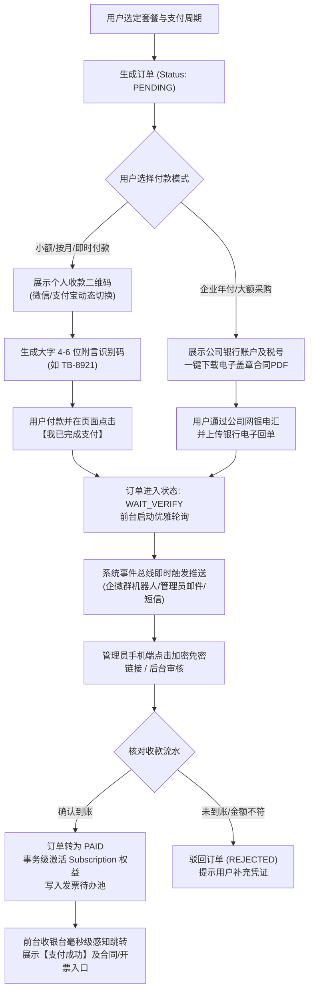

# 标讯通商业化支付系统归纳总结与全景演进设计方案

> **文件标识**：`docs/plans/2026-09-26-payment-system-design.md`  
> **文档版本**：v1.0.0 (Arch & Product Blueprint)  
> **设计日期**：2026-09-26  
> **核心主题**：现有系统功能归纳、优化点挖掘、支付模块过渡期与未来商户号平滑升级全景设计

---

## 1. 现有系统功能全景归纳总结

「标讯通」目前已构建起覆盖**数据采集、加工清洗、前台检索与分析、商业权益管控、企业后台治理**的完整 B2B 招投标商业情报体系。系统整体分为四大核心业务板块：

```
┌────────────────────────────────────────────────────────────────────────┐
│                              标讯通系统功能全景                          │
├───────────────────┬───────────────────┬──────────────────┬─────────────┤
│   1. 数据采集与加工   │   2. 前台情报与工具   │  3. 商业权益与支付  │ 4. 运营管理后台 │
├───────────────────┼───────────────────┼──────────────────┼─────────────┤
│ · 24+ 数据源技能   │ · 智能检索与多维筛选 │ · 4级会员阶梯体系 │ · 数据源运维监控│
│ · 1:1 原版公文快照 │ · 详情一页纸速览(AI) │ · 查阅/导出配额控制│ · 标讯维护与审核│
│ · 结构化分节解析   │ · 标王/金主/战区大盘 │ · 订单与合同存证  │ · 订单与发票审核│
│ · 严格全局去重机制 │ · 招投标工具箱(合规) │ · 支付与回调处理  │ · 租户与RBAC权限│
│ · 附件探测与下载   │ · 智能推送(微信/邮件)│ · OpenAPI与Token │ · 导出审计与风控│
└───────────────────┴───────────────────┴──────────────────┴─────────────┘
```

### 1.1 数据采集与加工引擎 (Crawler & Pipeline)
- **广度覆盖**：接入中央政府采购网、地方政采网、国家电网、中石化、中国移动、中国联通、中铁等 24 个标准化 Skill；
- **高保真公文归档 (`crawler/fidelity.ts`)**：创新采用样式白名单机制与公文 CSS 基座，实现官方原始公文 1:1 原版网页快照归档（全库覆盖率达 99.1%）；
- **结构化深度提取**：正文自动划分为项目信息、资质要求、时间节点、联系人等区块，表格转化为结构化纯文本；
- **唯一性与增量调度**：基于 `Tender.sourceUrl` 唯一索引实现原位无损升级，杜绝数据重复。

### 1.2 前台情报与工具服务 (Intelligence & Tooling)
- **标讯检索中心 (`/list`)**：支持地域多级联动、行业细分、预算区间、附件存在性等多维复合筛选与关键词高亮；
- **标讯详情双模态 (`/tender/[id]`)**：「一页纸速览（风险雷达、关键事实带、结构化分节）」+「原文展示（沙箱隔离 1:1 官方原貌、三档字号、存证打印）」；
- **决策情报大盘**：采购人（金主）履约画像、中标方（标王）竞争态势、行业赛道大盘、标讯横向对比盘；
- **投标智能辅助**：AI 废标风险排查、标书大纲生成、报价罗盘测算、案例与资质匹配度分析；
- **订阅推送中心 (`/watches`)**：支持关键词雷达监测与微信公众号/邮件自动化推送。

### 1.3 商业化与支付体系现状 (Commerce Core)
- **会员权益分级**：FREE 体验版、PRO 专业版（¥2,999/年）、TEAM 团队版（¥6,999/年）、ENTERPRISE 旗舰版；
- **配额守卫 (`quota.ts`)**：每日查阅篇数与导出条目控制，支持“今日已阅”免扣额重看；
- **交易数据流**：初步搭设 `Order`、`Subscription`、`PaymentEvent`、`Invoice` 模型，支持对公转账凭证上传。

### 1.4 管理与运营平台 (Admin Governance)
- **运行监控**：爬虫批次状态、异常预警与日志审计；
- **商务财务**：订单流核验、发票开具审批、大额导出留痕审计；
- **组织权限**：支持企业多成员组织租户及细粒度 RBAC 权限。

---

## 2. 现有系统优化空间与商业价值杠杆

针对当前系统的业务运转痛点，梳理出 5 大优化方向与优先级排序：

| 优化维度 | 现状与痛点 | 建议优化方案 | 商业价值 | 落地优先级 |
| :--- | :--- | :--- | :---: | :---: |
| **① 商业支付闭环** | 暂无对公商户号导致线上收款停滞；缺乏即时通知与快速核销机制 | **上线「个人扫码核销 + 企业对公合同打款」双轨收银台，实现移动端秒级放行** | **极高 (直接创收)** | **P0 (最优先)** |
| **② 移动生态触达** | 当前以 PC 浏览器为主，缺乏微信生态内快速查阅与移动支付能力 | 微信公众号/企微 H5 快速登录，支持微信内调起 JSAPI 支付与模板消息推送 | 高 (提高留存) | **P1** |
| **③ 项目生命周期串联** | 意向公告、招标公告、答疑更正、中标结果分散在不同记录 | 依据项目编号聚类，构建「项目全生命周期甘特图与总线图」 | 中高 (提升粘性) | **P1** |
| **④ 附件深度检索** | PDF/Word/Excel 附件仅供下载，内部实质清单无法全文搜索 | 引入异步文档解析/OCR，实现招标文件深层货物清单的全文检索 | 中 (建立壁垒) | **P2** |
| **⑤ 团队投标协作看板** | TEAM 套餐多成员仅能独立看标，缺乏企业内部标讯分派与跟进协作 | 打造团队投标协同看板（线索分派、跟标中、弃标、已中标沉淀） | 中 (促成大单) | **P2** |

---

## 3. 核心专项：支付模块系统全景设计 (针对暂无对公商户号)

在**暂无对公商户号**的前提下，采用 **「方案 A (个人码极速核销) + 方案 C (标准合同与对公电汇)」** 双轨并行策略，同时在底层实现**网关插件化解耦**，确保未来拿到微信/支付宝企业商户号时能够**零重构平滑切换**。

### 3.1 总体业务流程图



---

### 3.2 前台收银台交互与体验设计 (`/pay/[orderNo]`)

页面采用清晰的左右双栏布局（移动端自适应上下排布）：

1. **左侧：订单明细与安全信赖背书**
   - 展现订单编号、购买规格、包含权益清单；
   - 醒目标注**“增值税专用发票/普票全额抵扣”**与**“平台履约双向保障”**；
   - 提供直接预览并下载盖章版《标讯通企业技术服务协议》PDF 文件的通道。
2. **右侧：双 Tab 极简收银台**
   - **Tab 1: 手机扫码快捷付 (个人码)**
     - 提供微信收款码与支付宝收款码一键切换；
     - 重点大字突出**【专属附言识别码（如 8921）】**，带有一键复制按钮，辅以醒目文案：*“请在付款备注中填写此识别码，系统自动匹配入账”*；
     - 主按钮：**「我已扫码完成支付」**，点击后页面平滑变为柔和等待动效，前台静默每 3 秒发起一次状态探查。
   - **Tab 2: 企业对公打款 (银行电汇)**
     - 提供企业对公银行四要素（抬头全称、开户银行、银行账号、信用代码）一键复制卡片；
     - 支持将网银转账截图或银行回单 PDF 拖拽上传。
3. **大客户先行保障机制（可选）**：
   - 针对年付企业客户（因内部财务审批流耗时），支持上传内部审批单先行开通 72 小时紧急体验期，到期款项未到账自动平滑降级。

---

### 3.3 后台极速审核工作台与多渠道推送机制

1. **移动端免密一键审核**：
   - 用户点击支付或上传凭证后，企微机器人/邮件立即收到带订单摘要和**高强度 HMAC 签名的一键放行链接**；
   - 管理员在手机微信中点击链接即可核对银行流水并一键确认，无需登录电脑管理后台。
2. **管理后台订单看板 (`/admin/orders`)**：
   - 设立专门的「待核销待办」分类；
   - 支持底单凭证悬浮大图查看、放大与旋转；
   - 审核通过时自动联动会员期限（支持续期顺延或覆盖升级策略）。

---

### 3.4 数据库架构设计 (Prisma Schema 增强)

在现有模型基础上扩展过渡期核销与审核审计字段：

```prisma
model Order {
  id              Int       @id @default(autoincrement())
  orderNo         String    @unique @db.VarChar(64)
  userId          Int
  planId          Int
  billingCycle    String    @db.VarChar(16) // monthly / yearly
  amount          Decimal   @db.Decimal(10, 2)
  channel         String    @db.VarChar(32) // wechat / alipay / bank
  status          String    @default("PENDING") // PENDING / WAIT_VERIFY / PAID / REJECTED / CANCELLED
  
  // ── 过渡期专有字段 ──
  matchingCode    String?   @db.VarChar(16) // 专属附言识别码 (如 "8921", 建立唯一检索索引)
  proofUrl        String?                   // 付款凭证截图/回单路径
  paidNoticeAt    DateTime?                 // 用户点击“我已支付”时间
  
  // ── 审核审计轨迹 ──
  auditStatus     String    @default("PENDING") // PENDING / APPROVED / REJECTED
  auditNote       String?                   // 审核备注或驳回说明
  auditByUserId   Int?                      // 审核人 ID
  auditAt         DateTime?                 // 审核时间戳
  
  // ── 关联 ──
  user            User      @relation(fields: [userId], references: [id])
  plan            Plan      @relation(fields: [planId], references: [id])
  paymentEvents   PaymentEvent[]

  @@index([matchingCode])
  @@index([auditStatus, createdAt])
  @@index([status, createdAt])
}
```

---

### 3.5 未来官方商户号“无感切换”技术架构

为确保未来企业对公商户号审批通过后平滑切换，采用统一抽象的网关设计模式：

```
                    ┌── [ 模式 A: MANUAL_AUDIT 模式 (当前上线) ]
                    │    · 渲染个人收款码 / 对公账号 + 附言码
                    │    · 企微通知推送 + 管理员移动端/后台人工一键放行
[ 统一收银入口 ] ───┤
                    └── [ 模式 B: OFFICIAL_API 模式 (未来无感切换) ]
                         · 调用微信 Native V3 API / 支付宝当面付接口
                         · 渲染官方动态二维码 + 官方 Webhook 自动验签入账
```

- **切换成本为零**：底层 `Order`、`Subscription`、`Invoice` 的状态机完全一致。未来只需在后台环境变量填入商户私钥与证书，并将模式开关切为 `OFFICIAL_API`，系统前端即自动升级为全自动扫码，历史订单数据 100% 兼容。

---

## 4. 实施推进规划（按优先级）

```
阶段划分          核心目标                     关键交付物
─────────────────────────────────────────────────────────────────────────────
P0：收款与变现   打通双轨收银台与审核闭环       · 收银台双 Tab（个人码 + 企业对公合同）
(当前第一优先)   实现当天开单、秒级人工放行     · 附言识别码生成与回单上传
                                             · 企微/邮件即时推送与移动端一键审核
                                             · 订单状态流转与会员权益自动激活
─────────────────────────────────────────────────────────────────────────────
P1：转化与体验   提升成单率与客户复购           · 微信移动端内适配与 H5 扫码引导
(后续跟进)       降低决策门槛                   · 优惠券/抵扣码/首月体验价促销引擎
                                             · 会员到期前 7 天多渠道自动续费提醒
─────────────────────────────────────────────────────────────────────────────
P2：财税与官方商户 接入官方自动商户号与电子发票   · 微信 Pay v3 / 支付宝 Open API 官方参数填入即开
(合规深化)       银企互联自动化流水对账         · 诺诺/百望云电子发票一键开具
                                             · 银行流水定时拉取与附言码自动核销
```

---

## 5. 进阶黑科技：动账邮件监听与 100% 零人工准自动开通

在暂无商户号 API 的情况下，为彻底免除管理员人工盯账与手工点击的负担，系统支持接入**「动账邮件自动解析引擎」**：

```
[ 客户打款 (带附言码 8921) ]
             │
             ▼
[ 招商银行/工商银行/支付宝系统 ]
             │
             ├─────────────────────────────────────────────────┐
             ▼ (实时发送)                                       ▼
  【企业专用收信邮箱 (如 pay@toubiao.com)】             【客户微信/支付宝】
             │ (IMAP 实时监听 / Webhook)
             ▼
  【系统动账邮件监听 Worker (Node.js mailparser)】
             │
             ▼
   解析邮件正文正则匹配:
   · 到账金额: ¥2,999.00
   · 交易流水: 202609260021...
   · 附言/备注: TB-8921 ──► 提取出识别码 "8921"
             │
             ▼
   数据库原子查询:
   SELECT * FROM orders WHERE matchingCode = '8921' AND status = 'WAIT_VERIFY';
             │
        ┌────┴────┐
        ▼         ▼
     [ 匹配成功 ]  [ 未匹配/无备注 ]
        │         │
   【自动激活会员】 企微机器人推送给管理员人工干预
   无需任何人动手!
```

- **实现原理**：各商业银行（工行、招行、建行等）及支付宝均支持免费的“每笔动账即刻发送邮件通知”服务；
- **业务价值**：客户转账后 5~10 秒内邮件到达专用邮箱，系统后台 Worker 正则抓取附言码与金额，**瞬间自动给客户开通权益**。即使深夜无人值守，也能实现 95% 以上订单的秒级全自动交付。

---

## 6. 转化漏斗与收银台放弃挽留机制 (Exit-Intent Recovery)

统计表明超过 40% 的用户在进入收银台后会因决策犹豫而流失，系统部署三级阶梯式挽留漏斗：

1. **离开意图捕获 (Exit-Intent Modal)**：
   - 当检测到鼠标向上移出浏览器视窗（准备关闭标签页），弹出高转化挽留浮层：
     *“提示：今天下单立赠价值 ¥800 的《2026 全国重点工程标讯雷达月报》+ 30 次 AI 标书初审包”*；
2. **待付款延时召回通知 (T+15 分钟)**：
   - 订单创建 15 分钟后若仍处于 `PENDING`，系统自动发送温馨提醒邮件/短信：
     *“【标讯通】您关注的《2026 智慧医疗项目》有新的标段答疑公告，您待支付的 PRO 年付订单尚保留中，点击链接继续查看...”*。

---

## 7. 企业多席位协同扩容与离职资产继承模型 (Seat-based Model)

针对 **TEAM 团队版（¥6,999/年，含 5 席位）**，企业内部人员流动与业务扩张的配套设计：

1. **额外席位加购 (Seat Add-on)**：
   - 允许企业在后台随时加购席位（按 ¥699/席位/年）；
   - 系统自动按照当前团队会员剩余天数等比例折算差价；
2. **离职一键交接 (Asset Transfer)**：
   - 成员离职后，企业管理员一键注销该成员账号；
   - 该成员曾收藏的标讯、加星的商机、填写的投标跟进备注**100% 自动过户给指定的接手同事**，确保企业商业情报资产不流失；
3. **投标数据围栏 (Data Fence)**：
   - 管理员可配置数据隔离权限：一线销售只能看到分配给自己的标讯和竞争对手情报，核心大盘仅老板可见。

---

## 8. 合规电子合同全自动盖章与防伪验真 (E-Contract)

为免去采购人员来回邮寄纸质合同的折腾，系统内建具备法律效应的电子签约流：
1. **自动生成防伪哈希**：基于合同正文 + 订单号 + 甲乙方税号生成不可篡改的 `SHA-256` 存证摘要；
2. **一键生成高清晰度 PDF**：自带法律声明与公章印层，直接可作为国企/事业单位财务打款合规报销底件。

---

## 9. 五大极端异常边界推演与应对策略 (Edge Cases)

| 潜在风险场景 | 现象表现 | 系统风控与应对策略 |
| :--- | :--- | :--- |
| **① 客户忘记填附言码** | 微信/银行到账 ¥2,999，但附言栏为空 | 审核后台提供「按金额倒序匹配」功能，检索 30 分钟内相同金额的待付订单，对比昵称/银行账号后 4 位强行关联 |
| **② 多人同额并发打款** | 促销日 10 分钟内来了 5 笔相同金额打款 | 附言识别码（Matching Code）全局唯一强约束；后台并排展示订单时间与银行流水时间戳，秒级对齐 |
| **③ 实付金额少打/多打** | 年付应付 ¥2,999，客户手滑误转了 ¥2,899 | 审核界面点击【金额不符驳回】，输入原因“实收 ¥2,899，差额 ¥100”，客户收银台即刻显示红字提示补打 |
| **④ 管理员深夜离线** | 深夜客户付款，管理员已休息 | 客户等待超 10 分钟未处理时，收银台友好提示并自动补偿 3 天体验期，同时引导添加专属客服微信 |
| **⑤ 恶意点“我已支付”** | 用户未付款频繁狂点，试图刷屏 | 频控限流：单订单 5 分钟内最多触发 1 次通知；未上传底单的订单强制提示核对中 |

---

## 10. 结论

通过上述方案，「标讯通」既解决了眼下**“没有企业商户号就无法收单”**的商业化死局，以极低的开发与运维成本实现真金白银的变现；又在软件工程层面实现了高内聚低耦合的网关抽象，为后续对接正规微信/支付宝企业商户号打下了坚实的技术底座。
